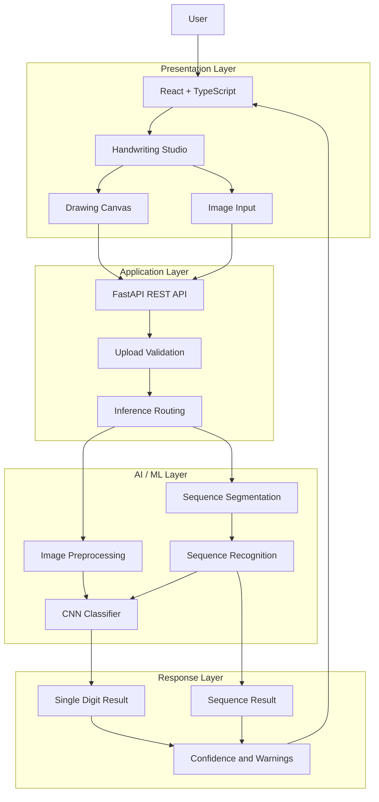

# NumerIQ Intelligence

### AI-Powered Handwritten Digit & Sequence Recognition Platform

<p align="center">
  <strong>Deep Learning · Computer Vision · PyTorch · FastAPI · React · TypeScript</strong>
</p>

<p align="center">
  An end-to-end platform for recognizing handwritten numerical input,
  experimenting with segmentation strategies, and serving predictions
  through a full-stack application.
</p>

<p align="center">
  <a href="https://github.com/Balaji-253/NumerIQ-Intelligence">Repository</a> ·
  <a href="https://github.com/Balaji-253/NumerIQ-Intelligence/issues">Issues</a> ·
  <a href="http://127.0.0.1:8000/docs">Local API Documentation</a>
</p>

---

## Table of Contents

- [1. Project Overview](#1-project-overview)
- [2. Problem Statement](#2-problem-statement)
- [3. Objectives](#3-objectives)
- [4. Key Capabilities](#4-key-capabilities)
- [5. System Architecture](#5-system-architecture)
- [6. Recognition Workflow](#6-recognition-workflow)
- [7. Technology Stack](#7-technology-stack)
- [8. Repository Structure](#8-repository-structure)
- [9. Getting Started](#9-getting-started)
- [10. Running the Application](#10-running-the-application)
- [11. API Documentation](#11-api-documentation)
- [12. Model and Experimentation](#12-model-and-experimentation)
- [13. Evaluation and Testing](#13-evaluation-and-testing)
- [14. Configuration](#14-configuration)
- [15. Security and Reliability](#15-security-and-reliability)
- [16. Known Limitations](#16-known-limitations)
- [17. Roadmap](#17-roadmap)
- [18. Troubleshooting](#18-troubleshooting)
- [19. Contributing](#19-contributing)
- [20. License](#20-license)

---

## 1. Project Overview

**NumerIQ Intelligence** is a full-stack handwritten digit recognition and sequence analysis platform built using deep learning and computer vision.

The project combines a convolutional neural network (CNN), image preprocessing, component-based segmentation, experimental sequence decoding, and REST API inference.

It supports two primary recognition workflows:

1. **Single-digit recognition:** Predicts an individual handwritten digit from an uploaded image.
2. **Sequence recognition:** Analyzes an image containing multiple handwritten digits and attempts to reconstruct the numerical sequence.

The backend exposes inference capabilities through FastAPI. A React and TypeScript frontend provides the user-facing application.

The repository also contains model training, evaluation, experimental decoding implementations, automated tests, and a legacy Streamlit interface.

### Project status

| Area | Current status |
|---|---|
| CNN training and evaluation | Implemented |
| Single-digit inference API | Implemented and integration-tested |
| Sequence recognition API | Implemented and integration-tested |
| Experimental segmentation and decoding | Implemented |
| FastAPI backend | Implemented |
| React + TypeScript frontend | Under active development |
| Automated test suite | 137 tests passed in the last recorded full run |
| Production deployment | Not yet completed |
| Independent multi-writer validation | Pending |

This is an actively developed engineering project. It is not currently presented as a certified or production-validated OCR system.

---

## 2. Problem Statement

Handwritten digit recognition is more complicated than classifying isolated, centered MNIST digits.

Real handwriting introduces challenges such as:

- Different writing styles and digit shapes.
- Variations in image size, position, and orientation.
- Uneven spacing between digits.
- Touching and overlapping digits.
- Noise, inconsistent strokes, and background artifacts.
- Ambiguous segmentation boundaries.
- Differences between benchmark datasets and real-world input.

A reliable sequence recognition system must solve two separate problems:

1. Determine where individual digits are located.
2. Correctly classify those digits and reconstruct their original order.

NumerIQ investigates both problems through a modular recognition pipeline and experimental decoding strategies.

---

## 3. Objectives

The engineering objectives are:

- Develop a CNN-based handwritten digit classifier.
- Build reusable image preprocessing and inference components.
- Support single-digit and multi-digit recognition APIs.
- Investigate connected-component segmentation and alternative segmentation hypotheses.
- Explore candidate ranking and beam-search-based sequence decoding.
- Expose inference through a documented REST API.
- Integrate backend inference with a modern frontend.
- Evaluate recognition quality using accuracy, character error rate, candidate recall, and latency.
- Maintain reproducible experiments and automated regression tests.
- Establish a foundation for future deployment and operational monitoring.

---

## 4. Key Capabilities

### 4.1 Single-digit recognition

The single-digit pipeline accepts an image and returns:

- Predicted digit.
- Model confidence score.
- Uncertainty indicator.
- Top candidate predictions.
- Model and inference metadata.

### 4.2 Multi-digit sequence recognition

The sequence pipeline analyzes an image containing multiple digits and returns:

- Predicted numerical sequence.
- Number of detected digits.
- Individual digit predictions.
- Per-digit confidence and uncertainty indicators.
- Bounding-box information when available.
- Recognition warnings.

Sequence recognition is especially sensitive to segmentation quality. Touching or overlapping digits may be merged or split incorrectly.

### 4.3 Experimental recognition research

The project includes experimental work on:

- Connected-component analysis.
- Geometric and projection-based segmentation.
- Alternative segmentation hypotheses.
- Candidate scoring.
- Beam-search-based sequence decoding.
- Search-budget management and path diversity.

Experimental decoders are retained for comparison and research. They are not automatically treated as production-ready improvements.

### 4.4 Backend observability

The FastAPI backend includes:

- Request identifiers.
- Structured request logging.
- Request processing time headers.
- Health and readiness endpoints.
- Bounded image uploads.
- Input image validation.
- Centralized HTTP error responses.

### 4.5 Frontend

The React application uses:

- React.
- TypeScript.
- Vite.
- Tailwind CSS.
- Lucide React.

The frontend includes a dashboard and handwriting workspace with drawing functionality and backend sequence recognition integration.

---

## 5. System Architecture

### 5.1 High-level architecture



### 5.2 Architectural responsibilities

| Layer | Responsibility |
|---|---|
| Presentation | User interaction, drawing, image input, and results |
| API | HTTP endpoints, validation, request handling, and errors |
| Preprocessing | Image normalization and preparation for inference |
| Classification | CNN-based digit prediction |
| Segmentation | Identification of candidate digit regions |
| Sequence decoding | Candidate evaluation and sequence reconstruction |
| Evaluation | Accuracy, error rate, recall, and latency measurement |

### 5.3 Recognition architecture

The single-digit path and sequence path share the model inference foundation, but their responsibilities differ.

**Single-digit path**

```text
Image
  |
  v
Upload validation
  |
  v
Image decoding
  |
  v
Preprocessing
  |
  v
CNN inference
  |
  v
Digit prediction
  |
  v
JSON response
```

**Sequence path**

```text
Handwritten sequence image
  |
  v
Upload validation
  |
  v
Image decoding
  |
  v
Image preprocessing
  |
  v
Connected-component analysis
  |
  v
Candidate segmentation
  |
  v
Digit classification
  |
  v
Candidate scoring / decoding
  |
  v
Sequence reconstruction
  |
  v
Predictions + warnings
```

---

## 6. Recognition Workflow

### Stage 1 — Image acquisition

The user provides an image through the application or API.

Supported backend upload formats:

- PNG
- JPEG
- WEBP
- BMP

### Stage 2 — Input validation

The backend validates:

- Uploaded content type.
- Image decoding.
- Image dimensions.
- Upload size.
- Empty or corrupted files.
- Unsupported multi-frame images.

### Stage 3 — Preprocessing

The decoded image is converted into the representation expected by the inference pipeline.

The preprocessing stage prepares the image for model inference and segmentation.

### Stage 4 — Digit classification

The CNN predicts digit classes from 0 through 9.

The output includes class predictions and model scores.

**Important:** Softmax confidence is not a calibrated probability of correctness.

### Stage 5 — Sequence segmentation

For multi-digit input, the system analyzes image components and candidate digit regions.

Connected or overlapping handwriting is a known challenge.

### Stage 6 — Sequence reconstruction

The sequence pipeline evaluates detected digit regions and produces an ordered numerical prediction.

Experimental decoders investigate alternative segmentation and candidate-search strategies.

### Stage 7 — Response delivery

The API returns structured JSON containing predictions, metadata, and warnings.

The frontend displays the recognition result.

---

## 7. Technology Stack

| Category | Technology | Purpose |
|---|---|---|
| Programming language | Python | Backend and ML |
| Deep learning | PyTorch | CNN model |
| Computer vision | OpenCV | Image processing |
| Image processing | Pillow | Image loading and transformations |
| Numerical computing | NumPy | Numerical operations |
| Data analysis | Pandas | Evaluation and experiment data |
| ML evaluation | scikit-learn | Classification metrics |
| Backend | FastAPI | REST API |
| ASGI server | Uvicorn | API serving |
| Validation | Pydantic | Data validation |
| Frontend | React | User interface |
| Frontend language | TypeScript | Type-safe application logic |
| Build tool | Vite | Frontend development and build |
| Styling | Tailwind CSS | UI styling |
| Testing | Pytest | Automated tests |
| Containerization | Docker | Backend container foundation |

---

## 8. Repository Structure

The repository is organized into backend, frontend, model artifacts, experiments, tests, and supporting tools.

```text
NumerIQ-Intelligence/
│
├── artifacts/
│   ├── mnist_cnn.pt
│   ├── evaluation_metrics.csv
│   └── audit.jsonl
│
├── experiments/
│   └── cnn_robustness_v2/
│
├── frontend/
│   ├── src/
│   │   ├── assets/
│   │   ├── services/
│   │   │   └── recognition.ts
│   │   ├── App.tsx
│   │   ├── App.css
│   │   ├── index.css
│   │   └── main.tsx
│   ├── package.json
│   └── package-lock.json
│
├── scripts/
│   └── Evaluation and experiment scripts
│
├── src/
│   ├── api.py
│   ├── inference.py
│   ├── sequence_recognizer.py
│   ├── v2_inference.py
│   ├── v2_sequence_recognizer.py
│   ├── v4_segmentation.py
│   ├── v4_hypothesis_generator.py
│   ├── v4_candidate_scorer.py
│   ├── v4_pipeline.py
│   ├── v5_sequence_decoder.py
│   ├── v53_sequence_decoder.py
│   └── Related model and pipeline modules
│
├── tests/
│   └── Automated test modules
│
├── ui/
│   └── app.py
│
├── data/
│   └── Dataset and evaluation data
│
├── Dockerfile
├── docker-compose.yml
├── requirements.txt
├── requirements-lock.txt
├── .gitignore
└── README.md
```

Some generated datasets and model artifacts may be excluded from Git. The structure above describes the main project organization rather than a guarantee that every generated file is tracked.

---

## 9. Getting Started

### 9.1 Prerequisites

Recommended development environment:

| Requirement | Version / Notes |
|---|---|
| Python | 3.11 |
| Node.js | Compatible with the installed Vite version |
| npm | Installed with Node.js |
| Git | Required |
| RAM | 8 GB minimum recommended; 16 GB preferable |
| GPU | Optional |
| Operating system | Windows, Linux, or macOS |

The project supports CPU inference and development. GPU acceleration is optional.

### 9.2 Clone the repository

```bash
git clone https://github.com/Balaji-253/NumerIQ-Intelligence.git
cd NumerIQ-Intelligence
```

### 9.3 Checkout the development branch

```bash
git checkout experiment/cnn-robustness-v1
```

### 9.4 Create the Python environment

Using Conda:

```bash
conda create -n digit_recognizer python=3.11 -y
conda activate digit_recognizer
```

Verify:

```bash
python --version
```

### 9.5 Install backend dependencies

```bash
python -m pip install --upgrade pip setuptools wheel
python -m pip install -r requirements.txt
```

If your environment reports that `email-validator` is missing during API or test initialization, install it with:

```bash
python -m pip install email-validator
```

For reproducible dependency installation, use the lock file after checking that it matches your Python and operating-system environment:

```bash
python -m pip install -r requirements-lock.txt
```

Do not install both dependency sets blindly into an already configured environment. Choose the appropriate installation method.

### 9.6 Install frontend dependencies

Open a terminal in the frontend directory:

```bash
cd frontend
npm install
```

Verify the frontend build:

```bash
npm run build
```

---

## 10. Running the Application

The recommended local development setup runs the FastAPI backend and React frontend in separate terminals.

### Terminal 1 — Backend API

From the repository root:

```bash
conda activate digit_recognizer
cd NumerIQ-Intelligence
python -m uvicorn src.api:app --reload --host 127.0.0.1 --port 8000
```

Backend:

```text
http://127.0.0.1:8000
```

API documentation:

```text
http://127.0.0.1:8000/docs
```

Health:

```text
http://127.0.0.1:8000/health
```

Readiness:

```text
http://127.0.0.1:8000/ready
```

### Terminal 2 — React frontend

```bash
cd NumerIQ-Intelligence/frontend
npm run dev
```

Open the local URL printed by Vite, normally:

```text
http://localhost:5173
```

The frontend recognition service defaults to:

```text
http://127.0.0.1:8000
```

To override the backend address, create `frontend/.env.local`:

```env
VITE_API_BASE_URL=http://127.0.0.1:8000
```

Restart the Vite development server after changing environment variables.

### Terminal 3 — Tests and development tasks

From the repository root:

```bash
conda activate digit_recognizer
python -m pytest -q
```

---

## 11. API Documentation

The backend exposes REST endpoints through FastAPI.

### 11.1 Endpoint summary

| Method | Endpoint | Purpose |
|---|---|---|
| GET | `/` | API information |
| GET | `/health` | Liveness check |
| GET | `/ready` | Model readiness check |
| POST | `/predict` | Single-digit prediction |
| POST | `/predict/sequence` | Multi-digit sequence prediction |

### 11.2 Single-digit prediction

**Request**

```http
POST /predict
Content-Type: multipart/form-data
```

Form field:

```text
file: image.png
```

Example using curl:

```bash
curl -X POST "http://127.0.0.1:8000/predict" \
  -F "file=@sample.png"
```

The response contains the predicted digit, confidence, uncertainty, candidate predictions, and model metadata.

### 11.3 Sequence prediction

**Request**

```http
POST /predict/sequence
Content-Type: multipart/form-data
```

Example:

```bash
curl -X POST "http://127.0.0.1:8000/predict/sequence" \
  -F "file=@handwritten_sequence.png"
```

The response contains:

- `status`
- `sequence`
- `digit_count`
- `digits`
- `warnings`

Each digit result may include position, prediction, confidence, uncertainty, bounding box, area, and candidate scores.

### 11.4 Health check

```bash
curl http://127.0.0.1:8000/health
```

### 11.5 Readiness check

```bash
curl http://127.0.0.1:8000/ready
```

Readiness verifies that the inference model and sequence recognition components have loaded.

For the complete request and response schemas, use:

```text
http://127.0.0.1:8000/docs
```

---

## 12. Model and Experimentation

### 12.1 CNN classifier

The original MNIST classifier uses a convolutional neural network.

The documented architecture is:

```text
Input: 1 × 28 × 28 grayscale image
        |
        v
Convolution (1 → 32)
        |
        v
ReLU + Max Pooling
        |
        v
Convolution (32 → 64)
        |
        v
ReLU + Max Pooling
        |
        v
Flatten
        |
        v
Fully Connected (3136 → 128)
        |
        v
ReLU
        |
        v
Fully Connected (128 → 10)
        |
        v
Digit Classes (0–9)
```

Training uses cross-entropy loss and the Adam optimizer.

### 12.2 Training

From the repository root:

```bash
python -m src.train --epochs 10 --batch-size 128 --learning-rate 0.001
```

The dataset is downloaded automatically by the training pipeline when it is not already available.

The best checkpoint is saved under:

```text
artifacts/mnist_cnn.pt
```

### 12.3 Evaluation

```bash
python -m src.evaluate
```

Evaluation generates classification metrics and supporting artifacts according to the evaluation implementation.

### 12.4 Model versions

The project contains multiple generations of inference and sequence recognition work.

| Version | Purpose |
|---|---|
| Original CNN | Baseline isolated digit classifier |
| V2 | Improved inference and sequence recognition foundation |
| V4 | Segmentation and alternative hypothesis generation |
| V5 | Beam-search-based sequence decoding |
| V5.1 | Experimental candidate-preservation strategy |
| V5.2 | Expanded global search experiment |
| V5.3 | Shared-budget and round-robin search experiment |

The experimental versions are retained to support reproducibility and comparison.

The best experimental result is not necessarily the newest implementation. Decoder selection should be based on measured accuracy, recall, error rate, and latency.

---

## 13. Evaluation and Testing

### 13.1 Automated tests

Run:

```bash
python -m pytest -q
```

The last recorded full test run completed with:

```text
137 passed in 13.52s
```

This is a historical local test result. Run the suite again in your own environment to verify the current checkout.

### 13.2 Evaluation metrics

The project uses or investigates:

| Metric | Meaning |
|---|---|
| Exact sequence accuracy | Percentage of sequences predicted completely correctly |
| Character error rate (CER) | Character-level edit errors relative to reference length |
| Candidate recall@K | Whether the correct sequence appears among the top K candidates |
| Digit count accuracy | Whether the predicted number of digits matches the reference |
| Mean latency | Average inference time |
| P50 latency | Median inference time |
| P95 latency | 95th percentile inference time |

### 13.3 Experimental real-handwriting evaluation

The recorded diagnostic dataset contains 22 handwritten samples from one writer using a digital tablet.

The strongest recorded experimental decoder, V5.1, achieved:

| Metric | Recorded result |
|---|---:|
| Exact sequence accuracy | 13.64% |
| Candidate recall@5 | 36.36% |
| Candidate recall@10 | 50.00% |
| Candidate recall@20 | 50.00% |
| Character error rate | 40% |
| Digit count accuracy | 40.91% |
| Mean latency | 338.425 ms |
| P95 latency | 667.464 ms |

**Interpretation**

These results demonstrate that sequence segmentation and recognition remain challenging.

The diagnostic dataset is small, contains only one writer, and its annotations have not been independently verified. It is not an independent population-level benchmark.

The measurements must not be interpreted as a general real-world accuracy guarantee.

### 13.4 Benchmark limitations

- MNIST accuracy does not directly represent natural handwriting accuracy.
- A small one-writer dataset cannot establish generalization.
- Touching and overlapping digits require further research.
- Softmax confidence is not calibrated correctness probability.
- Synthetic image performance must be reported separately from natural handwriting performance.

---

## 14. Configuration

### 14.1 Backend environment variables

| Variable | Purpose | Default |
|---|---|---|
| `NUMERIQ_ENGINE` | Select inference engine | `legacy` |
| `NUMERIQ_V2_CHECKPOINT` | V2 checkpoint location | Built-in V2 default |
| `NUMERIQ_CORS_ORIGINS` | Allowed frontend origins | Local Vite origins |

Example:

```bash
export NUMERIQ_ENGINE=v2
```

For Windows PowerShell:

```powershell
$env:NUMERIQ_ENGINE="v2"
```

To use a custom V2 checkpoint:

```powershell
$env:NUMERIQ_V2_CHECKPOINT="artifacts/experiments/cnn_robustness_v2/training/best_model.pt"
```

The selected engine must have its required checkpoint available.

The API validates the engine selection during application startup.

### 14.2 Frontend configuration

Create:

```text
frontend/.env.local
```

Add:

```env
VITE_API_BASE_URL=http://127.0.0.1:8000
```

Do not commit secrets or private credentials to Git.

---

## 15. Security and Reliability

The current backend includes several defensive controls.

### Implemented controls

- Maximum upload size of 5 MB.
- Maximum image dimensions of 3000 × 3000.
- Content-type validation.
- Image format validation.
- Corrupted image handling.
- Animated and multi-frame image rejection.
- Bounded upload reading.
- Request identifiers.
- Request duration response headers.
- Structured logging.
- Centralized HTTP error responses.
- Separate health and readiness checks.

### Additional production requirements

Before exposing the system to public or enterprise traffic, implement and verify:

- Authentication and authorization.
- Rate limiting and abuse prevention.
- HTTPS termination.
- Secure deployment configuration.
- Persistent prediction history, if required.
- Centralized monitoring and alerting.
- Model versioning and rollback.
- Load and concurrency testing.
- Resource limits and inference queue management.
- Privacy and data-retention policies.
- CI/CD and dependency vulnerability scanning.
- Independent model validation.

The development server must not be treated as a production deployment.

---

## 16. Known Limitations

The following limitations are important:

1. Natural handwriting recognition accuracy is not yet sufficient for a production guarantee.
2. Connected and overlapping digits may be segmented incorrectly.
3. The real-handwriting diagnostic dataset is small and single-writer.
4. Experimental beam-search decoding can introduce significant latency.
5. Confidence scores have not been calibrated against correctness.
6. The React application and backend are still undergoing integration and validation.
7. The existing Docker Compose configuration starts the FastAPI service and the legacy Streamlit UI. It does not currently represent the complete React frontend deployment.
8. Public production hosting and operational monitoring are not yet completed.

These limitations are tracked explicitly so that benchmark performance is not confused with production readiness.

---

## 17. Roadmap

### Recognition and machine learning

- [ ] Improve segmentation of touching and overlapping digits.
- [ ] Expand the handwriting dataset across multiple writers.
- [ ] Independently verify ground-truth annotations.
- [ ] Evaluate sequence-level architectures.
- [ ] Calibrate confidence and uncertainty.
- [ ] Establish writer-independent test sets.
- [ ] Compare decoder versions using consistent evaluation protocols.

### Full-stack application

- [ ] Complete single-digit frontend integration.
- [ ] Complete image upload workflow.
- [ ] Add visual bounding-box overlays.
- [ ] Improve recognition result visualization.
- [ ] Implement persistent prediction history.
- [ ] Complete dataset and evaluation dashboards.
- [ ] Add model and configuration management.

### Production engineering

- [ ] Add authentication and authorization.
- [ ] Add rate limiting.
- [ ] Add structured production telemetry.
- [ ] Add automated CI testing.
- [ ] Implement model artifact versioning.
- [ ] Align Docker Compose with the React architecture.
- [ ] Perform security and load testing.
- [ ] Deploy to a production environment.

---

## 18. Troubleshooting

### Backend does not start

Check that the correct Conda environment is active:

```bash
conda activate digit_recognizer
python --version
```

Install backend requirements:

```bash
python -m pip install -r requirements.txt
```

### Model checkpoint not found

Verify that the required model artifact exists under the expected `artifacts/` path.

For V2, verify the configured checkpoint path if `NUMERIQ_ENGINE=v2`.

### Frontend cannot reach the backend

Check that the backend is running:

```text
http://127.0.0.1:8000/health
```

Check the frontend environment variable:

```env
VITE_API_BASE_URL=http://127.0.0.1:8000
```

Check the configured backend CORS origins and restart both services after configuration changes.

### Frontend build fails

From `frontend/`:

```bash
npm install
npm run build
```

### Tests fail

Run:

```bash
python -m pytest -v
```

Use the Conda environment's `python` executable rather than an unrelated global Python installation.

---

## 19. Contributing

Contributions, bug reports, and technical suggestions are welcome.

### Development workflow

1. Fork the repository.
2. Create a feature branch.
3. Implement the change.
4. Add or update tests.
5. Run the relevant test suite.
6. Build the frontend if frontend files changed.
7. Submit a pull request with a clear technical description.

Example:

```bash
git checkout -b feature/improved-segmentation
```

Run backend tests:

```bash
python -m pytest -q
```

Run frontend build:

```bash
cd frontend
npm run build
```

---

## 20. License

No open-source license has been added to this repository yet.

Until a license is selected and committed, the repository should not be assumed to grant general permission to reuse, modify, or redistribute its code.

---

## Acknowledgements

- PyTorch
- FastAPI
- React
- TypeScript
- OpenCV
- Pillow
- scikit-learn
- MNIST dataset and its contributors

---

<p align="center">
  <strong>NumerIQ Intelligence</strong><br/>
  Building reliable handwritten numerical recognition through deep learning,
  computer vision, and rigorous engineering.
</p>
